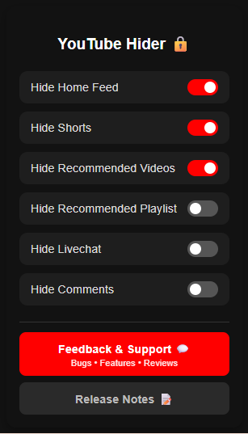

# YouTube Hider

> Take back control of your YouTube experience. Hide distracting elements and watch intentionally.

  

---

## Preview

  

---

## Features

- **Hide Home Feed** — Removes the video grid on the YouTube homepage
- **Hide Shorts** — Eliminates Shorts from all surfaces including horizontal shelves
- **Hide Recommended Videos** — Clears the sidebar of suggested content
- **Hide Recommended Playlists** — Removes playlist suggestions from view
- **Hide Comments** — Works on both standard videos and Shorts
- **Hide Live Chat** — Removes the live chat panel during streams

---

## Firefox — Easy Install

Install directly from the Firefox Add-ons store:
👉 [YouTube Hider on Firefox Add-ons](https://addons.mozilla.org/en-US/firefox/addon/youtube-hider/)

---

## Chrome / Edge / Brave — Manual Install

Chrome requires a $5 developer fee to publish on the Web Store — so instead of locking you out, the extension is open source and can be loaded manually for free.

1. Go to the [Releases page](../../releases) and download the latest `.zip`
2. Extract the folder
3. Open the extensions page in your browser:
   - Chrome: `chrome://extensions/`
   - Edge: `edge://extensions/`
   - Brave: `brave://extensions/`
4. Enable **Developer Mode**
5. Click **Load unpacked** and select the extracted folder

---

## Contributing

Pull requests are welcome. For large changes, please open an issue first.

1. Fork the repository
2. Create a new branch: `git checkout -b feature/your-feature`
3. Commit and push your changes
4. Open a Pull Request

---

## Bug Reports & Feature Requests

Use the **Feedback & Support** button inside the extension, or [open an issue](../../issues) on GitHub.

---

## Changelog

See [Releases](../../releases) for the full version history.

---

## License

This project is licensed under a modified MIT License with an attribution requirement — see [LICENSE](LICENSE).
---

Built by <a href="https://github.com/MuhammadAbuBakarQureshi">@MuhammadAbuBakarQureshi</a>

